<p align="center">
    
</p>

<h1 align="center">tada5hi/skills</h1>

<p align="center">
    <b>tada5hi's curated collection of agent skills.</b><br>
    Write an instruction once as a <code>SKILL.md</code> and stop pasting it into every prompt and repository.<br>
    One directory works in Claude Code, Codex, Cursor, Copilot, Gemini CLI and any other agent that reads Agent Skills.
</p>

<p align="center">
    <a href="https://github.com/tada5hi/skills/actions/workflows/ci.yml"></a>
    <a href="./LICENSE"></a>
    <a href="https://conventionalcommits.org"></a>
</p>

<p align="center">
    <a href="#installation"><b>Installation</b></a>
    ·
    <a href="#skills">Skills</a>
    ·
    <a href="#cli-manager">CLI Manager</a>
    ·
    <a href="#vendor-skills">Vendor Skills</a>
    ·
    <a href="#notes">Notes</a>
</p>

---

## Why tada5hi/skills?

Every project ends up telling its coding agent the same things: how a commit message is phrased, what a README looks like, how to handle review comments, how to plan a refactor. Without a shared place for that, the instructions live in prompts you retype and in `CLAUDE.md` fragments copied between repositories, and each copy drifts on its own.

A skill is that instruction written once. The agent reads each skill's `description` and loads the full `SKILL.md` only when your request matches it.

| Concern | Prompts and copied rule files | tada5hi/skills |
|---|---|---|
| **Repeated instructions** | Pasted into each session or copied into each repository | One `SKILL.md` per task, loaded on demand from its `description` |
| **Different agents** | One rule format per tool (`CLAUDE.md`, `.cursorrules`, …) | The [Agent Skills](https://agentskills.io) open standard: the same directory serves every supporting agent |
| **Updates** | Each copy is edited by hand, or not at all | The plugin has no pinned version, so every commit on `master` is an update |
| **Third-party skills** | Copied once; the source and version are lost | Git submodules under `vendor/`, a `SYNC.md` with the source SHA, and `skills:check` to report upstream commits |
| **Consistency** | Nothing notices a misnamed or orphaned file | CI checks that every directory has a `SKILL.md`, that its `name` matches the directory, and that it is registered in `src/meta.ts` |

The same skills, three ways in:

```bash
# any agent, through the skills CLI
npx skills add tada5hi/skills --skill='*'

# Claude Code
/plugin marketplace add tada5hi/skills
/plugin install skills@tada5hi

# Codex
codex plugin marketplace add tada5hi/skills
codex plugin add skills@tada5hi
```

Then ask for the task, for example "write a commit message for my changes", and the agent picks up `generate-commit-message`.

<p align="center">
    
</p>

**Table of Contents**
- [Installation](#installation)
- [Skills](#skills)
- [CLI Manager](#cli-manager)
- [Vendor Skills](#vendor-skills)
- [Adding New Skills](#adding-new-skills)
- [Structure](#structure)
- [Notes](#notes)
- [License](#license)

## Installation

### Skills CLI

The [skills CLI](https://github.com/vercel-labs/skills) installs into any agent that supports the Agent Skills standard (Claude Code, Cursor, VS Code Copilot, Gemini CLI, Goose, Roo Code and others):

```bash
# Install all skills
npx skills add tada5hi/skills --skill='*'

# Install a specific skill
npx skills add tada5hi/skills --skill='init-agent-docs'

# Install globally (available across all projects)
npx skills add tada5hi/skills --skill='*' -g
```

### Claude Code plugin

The repository is a Claude Code plugin marketplace named `tada5hi`. Its `skills` plugin bundles every skill:

```bash
/plugin marketplace add tada5hi/skills
/plugin install skills@tada5hi
```

To pull updates automatically, open `/plugin` → **Marketplaces** → `tada5hi` and turn on auto-update (it is off by default for third-party marketplaces). To update by hand, run `/plugin marketplace update tada5hi`.

### Codex plugin

Codex reads the same marketplace file (`.claude-plugin/marketplace.json`):

```bash
codex plugin marketplace add tada5hi/skills
codex plugin add skills@tada5hi
```

Then start a new session. To pull in new skills, run `codex plugin marketplace upgrade tada5hi`.

## Skills

Skills marked *vendor* are synced from another repository; the source is linked. Skills marked *frozen copy* came from a vendor that has since removed them: they stay as they were and no longer receive updates. *Manual only* skills run when you invoke them (for example `/grill-me`), never on their own.

### Documentation and writing

| Skill | Use it to |
|---|---|
| [init-agent-docs](skills/init-agent-docs/) | Scaffold `CLAUDE.md`, `AGENTS.md` and `.agents/*.md` for a repository |
| [update-agent-docs](skills/update-agent-docs/) | Propose improvements to the `init-agent-docs` templates back to this repository |
| [write-readme](skills/write-readme/) | Write a hero-led README with a "Why …?" section, theme-aware SVGs and verified samples |
| [write-release-notes](skills/write-release-notes/) | Write highlights-first GitHub release notes above the generated changelog |
| [generate-commit-message](skills/generate-commit-message/) | Generate a Conventional Commits message for uncommitted changes |
| [redesign-vitepress-site](skills/redesign-vitepress-site/) | Turn a default-looking VitePress site into a hero-led site with design tokens, landing sections and restyled chrome |

### Planning

| Skill | Use it to |
|---|---|
| [write-a-prd](skills/write-a-prd/) | Write a PRD through an interview and codebase exploration, filed as a GitHub issue (frozen copy from [mattpocock/skills](https://github.com/mattpocock/skills)) |
| [prd-to-plan](skills/prd-to-plan/) | Turn a PRD into a multi-phase plan in `./plans/` (frozen copy from [mattpocock/skills](https://github.com/mattpocock/skills)) |
| [prd-to-issues](skills/prd-to-issues/) | Break a PRD into independently grabbable GitHub issues (frozen copy from [mattpocock/skills](https://github.com/mattpocock/skills)) |
| [request-refactor-plan](skills/request-refactor-plan/) | Plan a refactor as tiny commits and file it as an issue (frozen copy from [mattpocock/skills](https://github.com/mattpocock/skills)) |
| [grilling](skills/grilling/) | Get interviewed about a plan until every branch of the decision tree is resolved (*vendor*, [mattpocock/skills](https://github.com/mattpocock/skills)) |
| [grill-me](skills/grill-me/) | Start a `grilling` session on demand (*vendor*, *manual only*, [mattpocock/skills](https://github.com/mattpocock/skills)) |
| [plan-status](skills/plan-status/) | Report progress on a plan file against the current codebase |

### Development workflow

| Skill | Use it to |
|---|---|
| [tdd](skills/tdd/) | Build features or fix bugs with red-green-refactor loops (*vendor*, [mattpocock/skills](https://github.com/mattpocock/skills)) |
| [triage-issue](skills/triage-issue/) | Find a bug's root cause and file an issue with a TDD fix plan (frozen copy from [mattpocock/skills](https://github.com/mattpocock/skills)) |
| [create-pull-request](skills/create-pull-request/) | Open a pull request from the current branch with a Conventional Commits title and an evidence-based body |
| [investigate-pr-comments](skills/investigate-pr-comments/) | Check each PR review comment against the code and fix the real issues |
| [release-please-version-bump](skills/release-please-version-bump/) | Give packages behind a linked release-please group a no-op `fix:` commit so they all release at the same version |
| [ponytail](skills/ponytail/) | Force the smallest solution that works: YAGNI, standard library first (*vendor*, [DietrichGebert/ponytail](https://github.com/DietrichGebert/ponytail)) |

### Code analysis

| Skill | Use it to |
|---|---|
| [audit-type-boundaries](skills/audit-type-boundaries/) | Find `as` casts and utility calls that hide property name mismatches in TypeScript |
| [security-audit](skills/security-audit/) | Audit trust boundaries with coverage-led hunting, independent validation and source-grounded reports (*vendor*, [cloudflare/security-audit-skill](https://github.com/cloudflare/security-audit-skill)) |
| [impact-analysis](skills/impact-analysis/) | Trace every consumer of a type, function or constant across a TypeScript monorepo |
| [improve-codebase-architecture](skills/improve-codebase-architecture/) | Find deepening opportunities, present them as an HTML report, then grill through the one you pick (*vendor*, *manual only*, [mattpocock/skills](https://github.com/mattpocock/skills)) |
| [codebase-design](skills/codebase-design/) | Shared vocabulary for deep modules, seams and interfaces, used by `tdd` and `improve-codebase-architecture` (*vendor*, [mattpocock/skills](https://github.com/mattpocock/skills)) |

### Projects, APIs and packages

| Skill | Use it to |
|---|---|
| [init-ts-project](skills/init-ts-project/) | Scaffold a TypeScript project from [`tada5hi/typescript-template`](https://github.com/tada5hi/typescript-template) |
| [query-api](skills/query-api/) | Query a live HTTP API from a base URL and credentials, using OpenAPI or rapiq conventions |
| [query-package-list](skills/query-package-list/) | Look up your own published packages in an awesome-style list before writing a utility |
| [refresh-package-list](skills/refresh-package-list/) | Sync the awesome-style package list with GitHub and npm, then open a PR |
| [link-skills](skills/link-skills/) | Link `skills/` into `.claude/skills/` so Claude Code discovers them locally |

## CLI Manager

The repository includes a CLI (`src/cli.ts`) for managing vendor skills and local development. It needs Node.js 22 or later:

```bash
npm install
```

| Command | Description |
|---|---|
| `npm run skills` | Show available commands |
| `npm run skills:init` | Add the vendor git submodules declared in `src/meta.ts` |
| `npm run skills:sync` | Pull the latest vendor changes and copy the declared skills into `skills/` |
| `npm run skills:check` | Report how many commits each vendor submodule is behind upstream |
| `npm run skills:cleanup` | Remove submodules and skill directories not declared in `src/meta.ts` |
| `npm run skills:link` | Symlink every skill into `.claude/skills/` for Claude Code discovery |

`src/meta.ts` is the single source of truth. It declares:

- **`manual`**: skills written in this repository, one entry per directory under `skills/`
- **`vendors`**: external repositories that maintain their own skills, with a map from source skill name to output name

## Vendor Skills

Vendor skills come from external repositories, cloned as git submodules into `vendor/` and copied into `skills/` by the CLI.

### Adding a Vendor Skill

1. Add an entry to `vendors` in `src/meta.ts`:

    ```ts
    export const vendors: Record<string, VendorSkillMeta> = {
        'some-project': {
            source: 'https://github.com/org/some-project',
            skillsPath: '.', // defaults to 'skills'
            skills: {
                'source-skill-name': 'output-skill-name',
            },
        },
    }
    ```

2. Add the submodule and sync:

    ```bash
    npm run skills:init
    npm run skills:sync
    ```

3. Link the new skill for local discovery:

    ```bash
    npm run skills:link
    ```

Each synced skill gets a `SYNC.md` with the source path, git SHA and sync date, and a `LICENSE.md` copied from the vendor repository when it has one.

### Updating Vendor Skills

```bash
npm run skills:check   # See what is outdated
npm run skills:sync    # Pull the latest and re-sync
```

## Adding New Skills

1. Create a directory under `skills/` named after the skill, following the `{verb}-{noun}` pattern
2. Add a `SKILL.md` with YAML frontmatter (`name` matching the directory, `description`) and the instructions
3. Add the name to the `manual` array in `src/meta.ts`
4. Run `npm run skills:link` to register it with Claude Code
5. Add it to the [skills tables](#skills) above

For skills that grow large, put one concept per file in a `references/` subdirectory and list them from `SKILL.md`; put deterministic helpers the skill runs in `scripts/`:

```text
skills/my-skill/
├── SKILL.md                # Instructions, index of references
├── references/
│   ├── core-syntax.md      # One concept per file
│   └── features-auth.md
└── scripts/
    └── validate.sh
```

## Structure

```text
skills/
├── src/
│   ├── cli.ts                 # CLI entry point
│   ├── meta.ts                # Skill registry (single source of truth)
│   ├── registry.ts            # Skill name resolution
│   ├── submodule.ts           # Git submodule helpers
│   ├── utils.ts               # Shared utilities
│   └── commands/              # init, sync, check, cleanup, link
├── skills/                    # One directory per skill (manual and synced vendor)
├── vendor/                    # Vendor repositories (git submodules)
├── test/unit/                 # Unit tests (mirrors src/)
├── .claude-plugin/            # Claude Code and Codex marketplace + plugin manifest
└── .github/
    ├── assets/                # README logo and diagrams
    └── workflows/ci.yml       # Lint, test, validate skills and registry
```

## Notes

- **Vendor skills are overwritten on every sync.** `skills:sync` deletes and re-copies each declared vendor skill directory. Local edits to a vendor skill are lost; change it upstream or turn it into a manual skill.
- **`skills:cleanup` deletes.** Any directory under `skills/` that is not declared in `src/meta.ts` is removed, together with undeclared submodules. Register a new skill before running it.
- **`skills:link` skips existing entries.** A `.claude/skills/<name>` that already contains a `SKILL.md` is left as it is, even when it is a copy rather than a link.
- **The plugin tracks `master`.** It has no pinned version, so an update brings in whatever `master` holds, including skill changes you have not reviewed.

## License

Made with 💚

Published under [Apache 2.0 License](./LICENSE).
